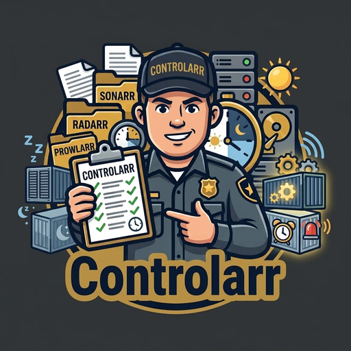

<p align="center"></p>

# Controlarr

Stop, start and restart your Docker containers at set times of day. Handy for
shutting down media or download containers overnight and bringing them back in
the morning.

Schedules use the plain 24-hour clock (`02:00`, `07:30`, `23:45`). No cron.

## Install on Unraid

The easiest way: open the **Apps** tab (Community Applications), search for
**Controlarr** and click **Install**.

To add it by hand instead:

1. Open the Unraid terminal (the `>_` icon at the top right) and run:

   ```sh
   wget -O /boot/config/plugins/dockerMan/templates-user/my-controlarr.xml \
     https://raw.githubusercontent.com/p1zzm1ssile/unraid-templates/main/templates/controlarr.xml
   ```

2. Go to the **Docker** tab, click **Add Container**, and pick **controlarr**
   from the **Template** list.
3. Check the settings (the web page uses port 8484 by default) and click **Apply**.
4. Click the Controlarr icon on the Docker tab and choose **WebUI**, then click
   **Schedule** next to any container to set its times.

Unraid passes your server's timezone to Controlarr automatically. To update,
use **Check for Updates** on the Docker tab as with any other container.

## Install with Docker Compose

The image is published at `ghcr.io/p1zzm1ssile/controlarr:latest`.

```sh
mkdir controlarr && cd controlarr
wget -O docker-compose.yml \
  https://raw.githubusercontent.com/p1zzm1ssile/controlarr/main/docker-compose.example.yml
# edit TZ and the example containers, then:
docker compose up -d controlarr
```

Then open `http://your-server:8080`.

To update later:

```sh
docker compose pull controlarr && docker compose up -d controlarr
```

To build the image yourself instead, clone this repository and swap the
`image:` line in the compose file for `build: .`.

## Quick start

```yaml
services:
  controlarr:
    image: ghcr.io/p1zzm1ssile/controlarr:latest
    container_name: controlarr
    restart: unless-stopped
    environment:
      - TZ=Europe/London
    volumes:
      - /var/run/docker.sock:/var/run/docker.sock
      - ./config:/config

  sonarr:
    image: lscr.io/linuxserver/sonarr:latest
    labels:
      - controlarr.stop=02:00
      - controlarr.start=07:00
```

Sonarr now stops at 02:00 and starts at 07:00 every day, London time.

## Web page

Open `http://your-server:8080` to see every container, its schedule, what
happens next and the start order. Click **Schedule** or **Edit** on a
container to set its times, days, load order and wait, or **Start now** /
**Stop now** to act straight away. The page has light and dark modes (Auto
follows your device).

Schedules added on the page are saved to `/config/schedules.yml`, so mount
`/config` to keep them. Schedules set with labels show on the page but can
only be changed in the labels.

Use **Pause** to stop a container's schedule running until you click
**Resume**, or **Skip next** to skip just its next scheduled time (for
example to keep Plex running late one night). These are kept in
`/config/state.json`, so they survive a restart.

**Recent activity** at the bottom of the page shows what Controlarr has
stopped, started and restarted since it last started, with any problems in
red.

Anyone who can open the page can stop and start your containers, so set
`CONTROLARR_WEB_PASSWORD` if it's reachable by anyone but you (the username
can be anything). Set `CONTROLARR_WEB_PORT=0` to turn the page off.

## Setting a schedule

Add labels to any container you want controlled:

| Label | Example | What it does |
|---|---|---|
| `controlarr.stop` | `02:00` | Stop the container at this time |
| `controlarr.start` | `07:00` | Start the container at this time |
| `controlarr.restart` | `04:00` | Restart the container at this time |
| `controlarr.days` | `mon-fri` | Only on these days (default: every day) |
| `controlarr.order` | `10` | Load order when several start together (lower first, default 100) |
| `controlarr.delay` | `60` | Seconds to wait after this one starts before the next |
| `controlarr.enable` | `false` | Ignore this container's schedule |

More than one time: `controlarr.restart=06:00, 18:00`

Different days for different times: put the days in front of the time,
for example `controlarr.stop=mon-fri 23:00, sat-sun 01:00`.

Days can be written as `mon`, `monday`, `mon-fri`, `sat,sun`, `fri-mon`,
`weekdays`, `weekends` or `daily`.

## Load order and start delays

When several containers are due to start at the same time, Controlarr starts
them one at a time so they don't all hit the CPU, RAM and disks at once.
All stops happen first, highest `controlarr.order` first, so apps stop before
the VPN or database they rely on. Then starts go in `controlarr.order`
(lowest first, ties by name).

After each start, Controlarr waits before starting the next one. The wait
belongs to the container that just loaded, and is chosen like this:

1. `controlarr.delay` on the container, if set (`0` means no wait).
2. If the container has a Docker healthcheck, wait until it reports healthy
   (at most `CONTROLARR_HEALTH_TIMEOUT` seconds). This matches the real load.
3. Otherwise a suggestion based on the app: for example Plex 90s,
   Jellyfin 60s, databases 45s, download clients 30s, *arr apps 20s,
   Prowlarr 15s. The full list is in `controlarr/delays.py`.
4. `CONTROLARR_START_DELAY` (30s) for anything it doesn't recognise.

A typical order: VPN and databases first, then download clients, then the
*arr apps, then media servers:

```yaml
  gluetun:   { labels: [controlarr.start=07:00, controlarr.order=1] }
  mariadb:   { labels: [controlarr.start=07:00, controlarr.order=2] }
  qbittorrent: { labels: [controlarr.start=07:00, controlarr.order=10] }
  sonarr:    { labels: [controlarr.start=07:00, controlarr.order=20] }
  plex:      { labels: [controlarr.start=07:00, controlarr.order=30, controlarr.delay=120] }
```

To see the order and the wait Controlarr will use for each container:

```sh
docker exec controlarr python -m controlarr plan
```

```
Starts and restarts, in load order (lower order goes first)
  order  container       action   when             wait after
      1  gluetun         start    07:00 every day  20s, suggested: VPN, needs time to connect
      2  mariadb         start    07:00 every day  until healthy (max 300s), waits for its healthcheck
     20  sonarr          start    07:00 every day  20s, suggested: *arr app, opens its database
     30  plex            start    07:00 every day  120s, set by controlarr.delay
```

### Without labels

If you can't change a container's labels, put its schedule in
`/config/schedules.yml` instead (see `config/schedules.example.yml`):

```yaml
containers:
  plex:
    stop: "01:30"
    start: "08:00"
    days: weekdays
    order: 30
    delay: 120
```

Quote the times in YAML (`"01:30"`), otherwise YAML may read them as numbers.

## Alerts

Set `CONTROLARR_NOTIFY_URL` to be told when something goes wrong, such as a
container that fails to start or doesn't become healthy:

- **Discord:** paste a channel webhook URL
  (`https://discord.com/api/webhooks/...`).
- **ntfy:** use your topic URL, for example `https://ntfy.sh/my-controlarr`,
  then subscribe to that topic in the ntfy app.
- Anything else that accepts a plain-text POST works too.

Only problems are sent. Set `CONTROLARR_NOTIFY_ALL=true` to also get a
message for every stop, start and restart.

## Settings

| Variable | Default | Meaning |
|---|---|---|
| `TZ` | `UTC` | Timezone the times are in |
| `CONTROLARR_DRY_RUN` | `false` | Log what would happen without doing it |
| `CONTROLARR_CATCH_UP` | `true` | On start, put containers into the state their schedule says (see below) |
| `CONTROLARR_CATCH_UP_DELAY` | `120` | Seconds to wait after starting before catching up |
| `CONTROLARR_POLL_SECONDS` | `30` | How often schedules are checked |
| `CONTROLARR_STOP_TIMEOUT` | `30` | Seconds to wait for a clean stop |
| `CONTROLARR_START_DELAY` | `30` | Wait after starting an app it doesn't recognise |
| `CONTROLARR_HEALTH_TIMEOUT` | `300` | Longest wait for a healthcheck to pass |
| `CONTROLARR_CONFIG` | `/config/schedules.yml` | Path to the optional schedule file |
| `CONTROLARR_LOG_LEVEL` | `INFO` | Log detail |
| `CONTROLARR_WEB_PORT` | `8080` | Port for the web page (`0` turns it off) |
| `CONTROLARR_WEB_PASSWORD` | (none) | Password for the web page |
| `CONTROLARR_NOTIFY_URL` | (none) | Discord webhook or ntfy URL for alerts |
| `CONTROLARR_NOTIFY_ALL` | `false` | Also alert on every stop, start and restart |

## Good to know

- Labels and the schedule file are re-read on every check, so changes take
  effect without restarting Controlarr (labels change when a container is
  recreated).
- **Catching up.** If Controlarr or your server was off when a time passed,
  Controlarr fixes it when it starts. A container with both a start and a
  stop time is put into the state it should be in now: so if your server
  reboots at 03:00 and Unraid starts everything, Sonarr is stopped again
  until 07:00. Containers with only a stop time or only a start time are left
  alone, so ones you start by hand stay running. Controlarr waits
  `CONTROLARR_CATCH_UP_DELAY` seconds first so the server has finished
  starting its containers. On Unraid, if you use long autostart waits, put
  Controlarr near the end of the autostart order. Set
  `CONTROLARR_CATCH_UP=false` to turn this off. The same catch-up runs if
  Controlarr loses contact with Docker for a while.
- **Clock changes.** When the clocks go back, a time between 01:00 and 02:00
  runs once, not twice. When they go forward, a time in the missing hour
  (01:00 to 01:59 in the UK) runs an hour later instead of being skipped.
- Use `restart: unless-stopped` on your containers. With `restart: always`,
  Docker will start a stopped container again if the Docker daemon restarts.
- Controlarr needs the Docker socket, which gives it full control of Docker.
  Only run images you trust.

## Development

```sh
pip install -r requirements.txt pytest
python -m pytest
```

## Licence

MIT, see [LICENSE](LICENSE).
